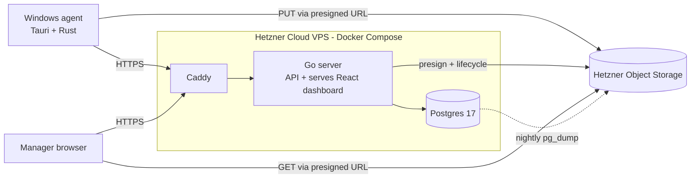

# WorkTrack - Research and Plan

Status: implementation has started.
See README.md and component documentation for the current implementation.

## Implementation decisions superseding earlier proposals

- Build our own React dashboard, Go API and Tauri Windows agent on Hetzner.
- Capture at fixed 600-second elapsed intervals while explicitly tracking, not randomly within clock windows.
- Measure exact elapsed durations, including partial blocks, rather than multiplying block count by ten minutes.
- Screenshot deletion must not automatically determine wages.
- Do not ask workers to disable Windows security controls as standard onboarding.
  Unsigned pilot installation is only acceptable where existing device policy allows it.
- Domain-only browser tracking cannot be obtained reliably from window titles alone and is deferred.
- Retention is not yet approved.
  Configure a documented retention policy before uploading real worker screenshots.
- Earlier pricing, estimated memory usage and alternative-tool findings are research notes, not validated deployment guarantees.

Date: 2026-10-21.
Working name: "WorkTrack" (placeholder).

## 1. Goal

Build a minimal tool to monitor remote workers on Windows.
It should prove hours worked with screenshots and activity levels, like Worksnaps.
It should stay small, cheap, and respectful of worker privacy.

## Decisions (2026-10-21)

| Question | Answer |
|---|---|
| Workers at launch | 20+ |
| PC ownership | Mixed: company-owned and personal |
| Project tracking in V1 | No, total hours only |
| Screenshot frequency | One every 10 minutes |
| Screenshot retention | Not decided, default 90 days |

What these decisions change:
- V1 has no projects. The timer is a single Start/Stop button.
- Screenshot time is random inside each 10-minute block (for example 10:03, then 10:17).
  This is still exactly one per 10 minutes, but workers cannot predict the moment.
- Personal PCs cannot use a self-signed certificate (we should not install trust certificates on personal machines).
  So unsigned install plus a guide is the plan for everyone, see section 7.
- With 20+ workers, some will have Smart App Control on.
  Budget for a real code signing certificate early, see section 7.

## 2. Market reference

| | Worksnaps | Insightful |
|---|---|---|
| Focus | Proof of hours for contractors | Workforce analytics for enterprises |
| Core | Screenshots, activity, timesheets | Productivity, capacity, shadow AI, workflow mapping |
| Price | $20/mo for 4 users up to $90/mo for 30 users, then $3/user | $8 to $16 per user per month (annual), plus add-ons |
| Trial | 30 days | 7 days |
| State | Dated product, last blog post 2021 | Active, AI-focused, 5,000+ organizations |

Takeaway: our V1 should match Worksnaps in features, with a modern, clean product.
Sources: worksnaps.net/www/pricing.shtml, insightful.io/pricing.

## 2b. Open-source alternatives (checked 2026-10-21 via GitHub API)

| Project | Screenshots + activity? | Windows app | License | Stars | Notes |
|---|---|---|---|---|---|
| **Ever Gauzy** (ever-co/ever-gauzy) | Yes | Yes, Electron "Desktop Timer" (latest v111.44.48, Sep 2026) | AGPL-3.0 | 8.4k | Full ERP/CRM/HRM platform. Time tracker is one module. Very active, but heavy to run. |
| **Cattr** (cattr-app) | Yes | Yes, Electron (`Cattr_Setup.exe`, v3.0.1, Sep 2026) | SSPL (MongoDB license) | ~240 | Focused on exactly our use case. Laravel server + Docker. Small community. |
| ActivityWatch | No screenshots | Yes | MPL-2.0 | 19k | Personal tracker on one PC. No team dashboard. |
| Kimai, solidtime, Traggo | No | Web only | AGPL / GPL | 1.6k to 9k | Manual timesheets. No desktop monitoring. |

Takeaways:
- Only **Ever Gauzy** and **Cattr** match the "screenshots + activity + team dashboard" use case.
- **Cattr is the closest fit** to our minimal V1 and can be self-hosted with Docker.
- Both agents are Electron (heavy), and both share our signing problem: we must build our own Windows installer pointed at our server, or use their unsigned or vendor-signed builds.
- License: AGPL and SSPL are fine for internal use.
  If we modify them and offer them to outside clients as a service, we must publish our source code.
  SSPL goes further and covers the whole service stack.
- Plan: **pilot Cattr first** (1 to 2 days to self-host).
  Build our own only if it does not fit (UI, performance, missing features, license).

### Windows signing check (2026-10-21)

The Authenticode signature block (the part of an `.exe` that holds the digital signature) was read from each installer's PE header.

| Installer | Signed? | Signer |
|---|---|---|
| Cattr `Cattr_Setup.exe` and `Cattr.exe` v3.0.1 | **No** (signature block size 0) | - |
| Gauzy `gauzy-desktop-timer-x64-111.44.48.exe` | **Yes** | "Ever Co. LTD", certificate from "Microsoft ID Verified CS EOC CA 03", with a Microsoft timestamp |

The Gauzy chain is Microsoft's Artifact Signing service.
The signature only covers their official build.
Rebuilding or rebranding the app removes it, and then we would need our own certificate.

**Updated plan: pilot Ever Gauzy, because Cattr fails the signing requirement.**
Self-host the Gauzy server and point the official signed Desktop Timer at it.
Confirm on a real Windows 11 PC that the timer accepts a custom server URL.

## 3. Features

### V1 - minimal (build first)

Worker app (Windows):
- Log in with email and password.
- Start and stop timer (no projects in V1).
- One screenshot every 10 minutes, at a random moment inside each 10-minute block.
- Activity % per block (active seconds divided by 600).
- Idle detection: no input for 5 minutes, then ask "keep or discard this time?".
- Worker can view and delete their own screenshots (deleting also removes that block's time).
- Tray icon that shows whether tracking is on or off.
- Consent screen on first launch.
- Offline buffer: data is saved locally and uploaded when back online.

Manager dashboard (web):
- Workers list with "working now" status.
- Daily timeline of 10-minute blocks with screenshot and activity %.
- Hours per worker per day and week.
- CSV export for payroll.
- Invite workers by email.
- Roles: Owner, Manager, Worker.

### V2 - next

- Projects and tasks on the timer.
- App and website usage (active window title and process name).
- Productive, unproductive, neutral labels for apps.
- Manual time entry with approval.
- Weekly timesheet approval.
- Hourly rates and pay totals.
- Alerts (low activity, long idle, no work started) by email or Slack.
- Screenshot blur option.
- Auto-delete screenshots after N days.

### V3 - only if needed

- AI tool usage reports, meeting time.
- Client invoices and payouts.
- Screen recording, on-demand screenshots.
- SSO, audit log, Jira or Asana integration, API and webhooks.
- macOS agent.

### Explicitly out of scope

- Keystroke logging (recording what is typed).
- Tracking when the timer is off.
- Hidden or "stealth" mode.

## 4. Architecture

Everything server-side runs on Hetzner (decision 2026-10-21: no Vercel, no other cloud).



Three parts:
1. **Agent** on the worker's PC.
2. **Backend API** that stores data.
3. **Dashboard** for the manager.

Parts 2 and 3 ship as one Go binary in one Docker container.
The React dashboard is built to static files and embedded into the Go binary with `go:embed`.
The Go server answers `/api/*` and serves the dashboard for every other path.

## 5. Tech stack

| Layer | Choice | Reason |
|---|---|---|
| Agent shell | Tauri 2 | Small installer, low memory, Rust access to Windows APIs, can add macOS later |
| Agent UI | React + TypeScript (Vite) | Same tools as the dashboard |
| Agent logic | Rust | Timers, screenshots, idle checks, uploads |
| Screenshots | `xcap` crate | Supports Windows 8.1+, all monitors, Apache-2.0 license |
| Idle and activity | Win32 `GetLastInputInfo` via `windows` crate | Built into Windows, no keyboard hooks, lower antivirus risk |
| Active app (V2) | Win32 `GetForegroundWindow` + `GetWindowTextW` | Built into Windows |
| Local buffer | SQLite (`rusqlite`) | Survives crashes and offline periods |
| Autostart | `tauri-plugin-autostart` | Official plugin, supports Windows |
| Auto-update | `tauri-plugin-updater` | Official plugin, uses its own free signing key |
| Backend language | Go (latest stable) | Single static binary, low memory, simple deploys, strong standard library |
| HTTP router | Go standard library `net/http` (`ServeMux` with method and path patterns) | No framework needed for about 10 endpoints |
| Database access | `pgx` v5 + `sqlc` | Write plain SQL, `sqlc` generates typed Go functions. No ORM. |
| Migrations | `goose` | Plain `.sql` files, run on server start |
| Object Storage client | `aws-sdk-go-v2` (S3) | Presigned PUT and GET URLs against Hetzner's S3 endpoint |
| Auth | Own code: `argon2id` password hashes, sessions table in Postgres | Small surface. Dashboard uses an HttpOnly cookie. Agent uses a long-lived device token in the `Authorization` header. |
| Logging | `log/slog` (standard library) | Structured JSON logs, no extra dependency |
| Config | Environment variables | Set in `docker-compose.yml` from an env file on the server |
| Dashboard | React + TypeScript + Vite | Plain single-page app, no server rendering needed for an internal tool |
| Dashboard routing and data | TanStack Router + TanStack Query | Typed routes, caching and refetching for API calls |
| Dashboard UI | Tailwind CSS + shadcn/ui | Ready-made accessible components, no design system to build |
| Database | Postgres 17 in Docker | Self-hosted on the same VPS |
| File storage | Hetzner Object Storage (S3-compatible) | Presigned URLs, built-in object expiry for screenshot retention, 1 TB included in base price |
| Reverse proxy + HTTPS | Caddy | Automatic Let's Encrypt certificates, one short config file |
| Server | Hetzner Cloud VPS, Ubuntu 24.04 LTS, Docker Compose | One machine runs Caddy, the Go server, Postgres |
| Firewall | Hetzner Cloud Firewall | Free, only ports 22 (SSH, your IP only), 80, 443 open |
| Backups | Nightly `pg_dump` to Object Storage + Hetzner server backups | Two independent copies of the database |
| Agent updates | `latest.json` + installer in an Object Storage bucket | Tauri updater reads it, stays inside Hetzner |
| CI and builds | GitHub Actions | `windows-latest` builds the installer. Linux runner builds the dashboard, then the Go binary, then the Docker image, and deploys over SSH |
| Container registry | GitHub Container Registry (GHCR) | Free for private images, only stores build output |
| Repo layout | One git repo: `agent/` (Tauri), `server/` (Go), `web/` (React dashboard), `deploy/` (Compose, Caddyfile) | Each part builds on its own. pnpm workspace links `agent/` and `web/` for shared TypeScript types. |

Not used anymore: Vercel, Neon, Cloudflare R2, Next.js, Drizzle, Better Auth.

### Why Go + React instead of Next.js

- The dashboard is behind a login, so server rendering and SEO add nothing.
- One Go binary holds the API and the dashboard files, so deploy is "copy one container and restart".
- Go uses about 20 to 50 MB of RAM at this scale, which leaves room on a 4 GB VPS.
- Plain SQL with `sqlc` keeps queries readable and fast, with type checking at compile time.

### API contract between Go, React and the agent

- Keep an `openapi.yaml` in `server/` as the single source of truth.
- Generate TypeScript types for `web/` and the agent UI with `openapi-typescript`.
- The Rust agent uses small hand-written `serde` structs for the 3 endpoints it calls.

### Hetzner layout

| Item | Choice | Why |
|---|---|---|
| Location | eu-central (Falkenstein FSN1 or Nuremberg NBG1) | Object Storage exists only in FSN1, NBG1, HEL1. Keeping the VPS in the same zone makes VPS-to-storage traffic free. India to Germany latency (about 150 ms) is fine because uploads run in the background. |
| VPS size | 2 vCPU, 4 GB RAM, 80 GB NVMe (CPX22, or CX23 / CAX11 if in stock) | Plenty for 25 workers. Postgres stays under 1 GB for a long time. Several types showed "not available" on 2026-10-21, so pick whatever 4 GB type is in stock. |
| Object Storage | 1 bucket `worktrack-screenshots` (private), 1 bucket `worktrack-backups` (private, object lock), 1 bucket `worktrack-releases` (public read) | Separate rules per purpose |
| Retention | Object expiry rule on `worktrack-screenshots` (default 90 days) | Hetzner deletes old screenshots for us, no cron job needed |
| Domain | `app.<yourdomain>` A record to the VPS IP | Caddy gets the HTTPS certificate on first request |

### Deployment flow

1. Push to `main`.
2. GitHub Actions builds the React dashboard, embeds it into the Go binary, builds a small Docker image (distroless or `scratch`), and pushes it to GHCR.
3. The action SSHes into the VPS and runs `docker compose pull && docker compose up -d`.
4. The Go server runs `goose` migrations on start.

Agent release flow:
1. Push a tag like `agent-v0.1.0`.
2. GitHub Actions on `windows-latest` builds the NSIS installer and the updater signature.
3. The action uploads the installer and `latest.json` to the `worktrack-releases` bucket.
4. Agents pick up the update on next check.

### Things Hetzner does not do for us

- **No managed Postgres.** We run it ourselves, so backups and upgrades are our job (covered above).
- **Email.** Hetzner Cloud blocks outgoing mail ports 25 and 465 by default.
  V1 avoids email: the dashboard creates an invite link that you copy and send on WhatsApp or Slack.
  If email is needed later, use an SMTP provider on port 587 (for example Brevo or Amazon SES).
- **No single-click rollbacks like Vercel.** Rollback means deploying the previous image tag.

### Why Tauri over the alternatives

| Option | Verdict |
|---|---|
| Tauri | Chosen. Small and light, Rust gives direct Win32 access. |
| .NET (WPF or WinUI) | Very good for Windows, but adds C# and blocks a future macOS agent. |
| Electron | Easiest for web developers, but about 150 MB and heavy for an always-on app. |

## 6. Windows agent details

### How each feature works

| Feature | Method |
|---|---|
| Screenshot | `xcap::Monitor::all()`, capture each monitor, stitch or upload separately, resize to max 1280 px wide, encode as JPEG quality 70 (about 100 to 200 KB) |
| Activity % | Poll `GetLastInputInfo` every 1 second. If last input changed since the previous poll, count that second as active. |
| Idle | If time since last input is more than 5 minutes, pause the block and show a prompt when the worker returns. |
| Blocks | Fixed 10-minute windows aligned to the clock (10:00, 10:10, ...). Each block holds start time, active seconds, and screenshot key. |
| Upload | Every block end: ask API for a presigned Object Storage URL, PUT the JPEG, POST block metadata. Retry from SQLite on failure. |
| Autostart | Registry Run key through the autostart plugin. The app opens to the tray, timer stays off until the worker starts it. |

### Notes from Microsoft docs

- `GetLastInputInfo` only reports input for the current user session.
  This is fine because the agent runs inside the worker's session.
- Its tick count is "not guaranteed to be incremental", so the code must handle values that go backwards.
- No Windows permission prompt is needed for screenshots, unlike macOS.

### Installer

- Tauri builds two Windows installers: NSIS (`-setup.exe`) and MSI.
- Use **NSIS** with per-user install, so workers do not need admin rights.
- MSI can only be built on Windows, so builds run on GitHub Actions.
- WebView2 is preinstalled on Windows 10 and 11. Default mode downloads it only if missing.

## 7. Code signing - can we skip it?

**Short answer: yes, for a small team you control.**
Signing is not required to install or run a Windows app.
Tauri's docs say signing is only needed for the Microsoft Store and to avoid the SmartScreen warning.

### What happens without signing

| Check | What the worker sees | Can they get past it? |
|---|---|---|
| SmartScreen | Blue "Windows protected your PC" screen on files downloaded through a browser | Yes: click "More info", then "Run anyway" |
| Smart App Control (Windows 11) | App is blocked outright | **No per-app bypass.** Only turning Smart App Control off (Windows Security settings) |
| Antivirus heuristics | Defender may flag an unsigned app that takes screenshots | Usually yes, and we can report a false positive to Microsoft |
| Tauri auto-updater | Not affected | Updater uses its own free key pair, separate from Windows signing |

Smart App Control is the main risk.
Microsoft says it turns on automatically "in most cases" on Windows 11.
Windows turns it off on its own for enterprise-managed PCs, developer-mode PCs, and users it sees doing developer-style work.
Recent Windows updates let users turn it off and on again without reinstalling Windows.
Workers can check it at Windows Security > App & browser control > Smart App Control.

### Ways to install without signing

1. **Download and click "Run anyway"** (simplest).
   Send a short guide with screenshots of the two clicks.
2. **Remove the "downloaded from internet" mark before running.**
   SmartScreen triggers on a hidden `Zone.Identifier` tag (called Mark of the Web) that browsers add.
   PowerShell can remove it: `Unblock-File -Path .\WorkTrack-setup.exe`.
3. **PowerShell one-line installer.**
   A script downloads the installer with `Invoke-WebRequest` and runs it silently.
   Files saved this way usually do not get Mark of the Web, so SmartScreen does not show.
   Needs testing on a real Windows 11 PC before relying on it.
4. **Deliver by USB or a shared drive.**
   No browser download means no Mark of the Web, so no SmartScreen.
5. **Self-signed certificate (company PCs only).**
   Create your own certificate, sign the app, and install the certificate as trusted on each PC.
   Needs admin rights on every PC, so it only fits PCs you manage.

### Recommended path

- **Pilot (first 3 to 5 workers):** ship unsigned.
  Use option 1 or 3, plus a one-page install guide.
  Check Smart App Control on each PC during onboarding.
- **Company PCs:** you may also use option 4 (USB or shared drive), or option 5 (self-signed) since you control them.
- **Personal PCs:** options 1 to 3 only.
  If Smart App Control is on, the worker must turn it off, which is a lot to ask for a personal machine.
- **Full rollout (20+ workers):** buy an OV code signing certificate before rolling out to everyone.
  This is the cleanest fix for personal PCs.

### Paid signing options (for later)

| Option | Fit for us | Notes |
|---|---|---|
| Azure Artifact Signing (was "Trusted Signing") | **Not available in India today** | Individual developers must be in the US or Canada. Organizations only in the US, Canada, EU, UK, Australia, NZ, Japan, South Korea, Singapore, Switzerland, Norway, Israel. Needs a paid Azure subscription. Basic tier includes 5,000 signatures per month. |
| OV certificate from a CA (Sectigo, SSL.com, Certum, DigiCert) | Works from India | Price not verified, roughly $200 to $500 per year. Key must live on a hardware token or cloud HSM, so pick a CA with cloud signing for GitHub Actions. |
| SignPath Foundation | No | Free, but only for open source projects. |

Correction to my earlier advice: I suggested Azure signing at about $10 per month.
It is not open to individuals or companies in India right now.

Important: signing does not remove SmartScreen right away.
Microsoft says the prompt stops "once the file hash has sufficient download history".
A new certificate still shows warnings until it builds reputation.

## 8. Data model (first draft)

```text
organizations   id, name, created_at
users           id, org_id, email, name, role (owner|manager|worker), hourly_rate, created_at
sessions        id, user_id, kind (browser|device), token_hash, device_id, expires_at, created_at
invites         id, org_id, role, token_hash, expires_at, used_at
devices         id, user_id, hostname, agent_version, last_seen_at
blocks          id, user_id, device_id, start_at, active_seconds, idle_discarded, deleted_by_worker
screenshots     id, block_id, object_key, taken_at, width, height, bytes
consents        id, user_id, version, accepted_at
```

One row in `blocks` per 10 minutes worked.
Hours = count of non-deleted blocks x 10 minutes.

## 9. API (first draft)

| Method | Path | Who | Purpose |
|---|---|---|---|
| POST | `/api/auth/login` | All | Email and password. Dashboard gets a session cookie. Agent gets a device token. |
| POST | `/api/auth/logout` | All | End the session or revoke the device token |
| POST | `/api/auth/accept-invite` | New worker | Set password from an invite link |
| POST | `/api/uploads/screenshot-url` | Agent | Returns a presigned Object Storage PUT URL |
| POST | `/api/blocks` | Agent | Save one or more finished blocks |
| DELETE | `/api/blocks/:id` | Worker | Delete own block and screenshot |
| GET | `/api/timeline?user&date` | Manager | Blocks with signed screenshot URLs |
| GET | `/api/reports/hours?from&to` | Manager | Hours per worker |
| GET | `/api/reports/hours.csv` | Manager | CSV export |
| POST | `/api/invites` | Owner, Manager | Invite a worker |

## 10. Privacy and legal

- Tell workers in writing what is tracked, when, and why. Get signed consent.
- Track only while the timer is running.
- Never record keystroke content.
- Let workers see and delete their own data.
- Delete screenshots after a fixed period (default 90 days).
- India's DPDP Act 2023 and the EU GDPR both expect notice, consent or a lawful basis, and data minimization.
  Get legal advice before rolling out to workers in other countries.

## 11. Cost estimate (25 workers)

Screenshot volume: 6 per hour x 8 hours x 22 days x 25 workers = about 26,400 per month.
At about 150 KB each, that is about 4 GB per month, or about 12 GB kept at 90 days.
Multi-monitor workers add more.

| Item | Cost |
|---|---|
| Hetzner VPS (4 GB) | About €6.49 to €10 per month excl. VAT (Regular Performance plans start at €6.49, exact price depends on type and stock) |
| Hetzner server backups | 20% of the VPS price, about €1.50 to €2 per month (not re-verified) |
| Hetzner Object Storage | €6.49 per month base, includes 1 TB storage and 1 TB egress. We use about 12 GB, so no extra cost. API calls are free. |
| Domain | About €10 per year |
| Code signing | $0 now (unsigned). Later about $200 to $500 per year. |
| **Total** | **About €15 to €20 per month excl. VAT** |

This is a flat cost that barely changes between 25 and 200 workers.

## 12. Risks and open questions

| Risk | Mitigation |
|---|---|
| Smart App Control blocks unsigned app | Check on each worker PC during onboarding, buy a certificate if it becomes common |
| Defender flags the agent | No keyboard hooks, no hidden mode, clear app name, submit false positives |
| Worker kills the app | Dashboard shows "last seen" per device, and gaps show as missing time |
| Fake activity (mouse jigglers) | Out of scope for V1, screenshots are the main proof |
| Multi-monitor screenshots are large | Resize and compress, one image per monitor |

Open questions for the owner:
- Screenshot retention period (default 90 days)?
- Is the company registered in a country that Azure Artifact Signing supports?

## 13. Next steps

1. Confirm screenshot retention.
2. Scaffold the repo (`agent/`, `server/`, `web/`, `deploy/`).
3. Build the agent core: timer, blocks, idle, screenshot, SQLite buffer.
4. Build the API and database schema.
5. Build the dashboard timeline and CSV export.
6. Set up GitHub Actions to build the unsigned NSIS installer.
7. Pilot with 2 to 3 workers, then test the unsigned install flow on a fresh Windows 11 PC.

## 14. Sources

- Tauri Windows code signing: https://v2.tauri.app/distribute/sign/windows/
- Tauri Windows installer: https://v2.tauri.app/distribute/windows-installer/
- Tauri updater: https://v2.tauri.app/plugin/updater/
- Tauri autostart: https://v2.tauri.app/plugin/autostart/
- Smart App Control FAQ: https://support.microsoft.com/en-us/topic/what-is-smart-app-control-285ea03d-fa88-4d56-882e-6698afdb7003
- Azure Artifact Signing quickstart (eligibility): https://learn.microsoft.com/en-us/azure/artifact-signing/quickstart
- Azure Artifact Signing FAQ: https://learn.microsoft.com/en-us/azure/artifact-signing/faq
- `Unblock-File`: https://learn.microsoft.com/en-us/powershell/module/microsoft.powershell.utility/unblock-file
- `GetLastInputInfo`: https://learn.microsoft.com/en-us/windows/win32/api/winuser/nf-winuser-getlastinputinfo
- xcap: https://github.com/nashaofu/xcap
- Hetzner Cloud: https://www.hetzner.com/cloud/
- Hetzner Regular Performance plans: https://www.hetzner.com/cloud/regular-performance/
- Hetzner Object Storage (pricing, locations, expiry, presigned URLs): https://www.hetzner.com/storage/object-storage/
- SignPath Foundation: https://signpath.org/
- Worksnaps pricing: https://www.worksnaps.net/www/pricing.shtml
- Insightful pricing: https://www.insightful.io/pricing
